<!-- Generado por scripts/build.py — edita config.json, no este archivo. -->

<b>Curioso por naturaleza. Construyendo por necesidad.</b> Tecnología, automatización, infraestructura y productos digitales. De una idea a un sistema funcionando.

<a href="https://aviarockets.com">aviarockets.com</a> &nbsp;·&nbsp; <a href="mailto:hola@aviarockets.com">hola@aviarockets.com</a>

